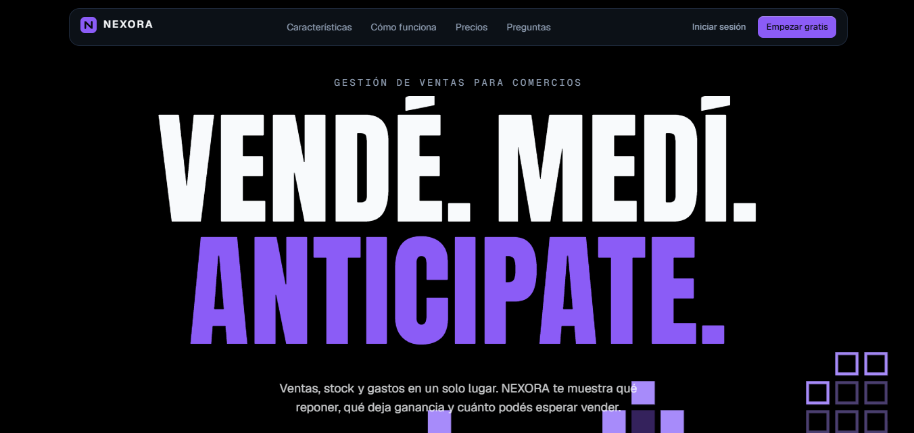
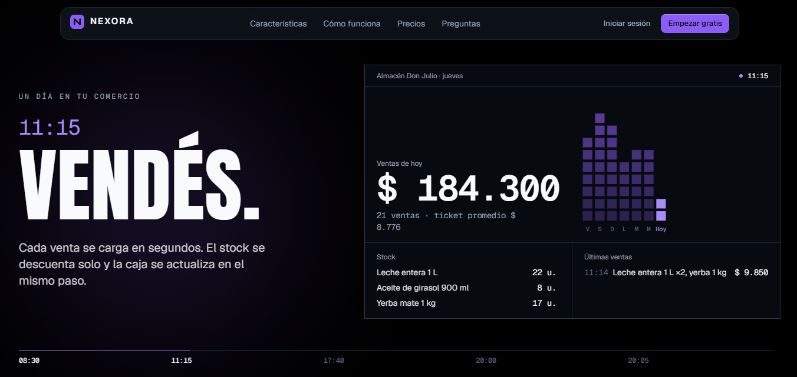
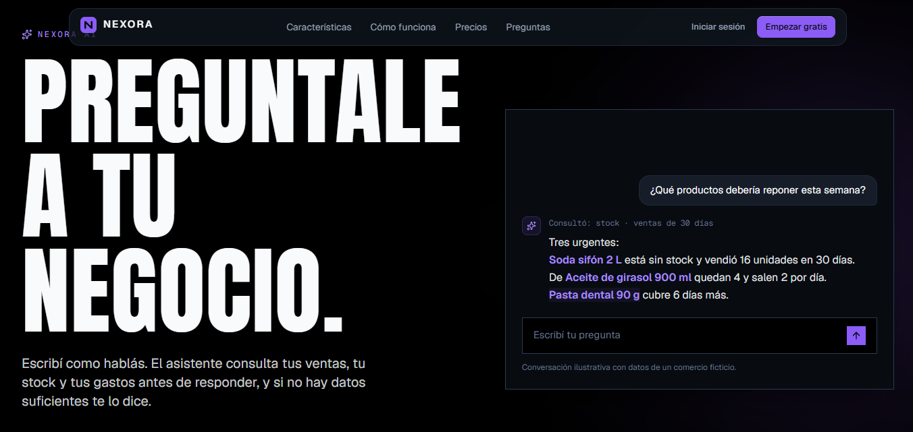
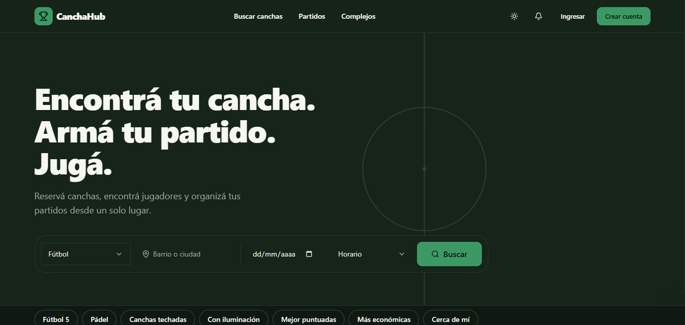
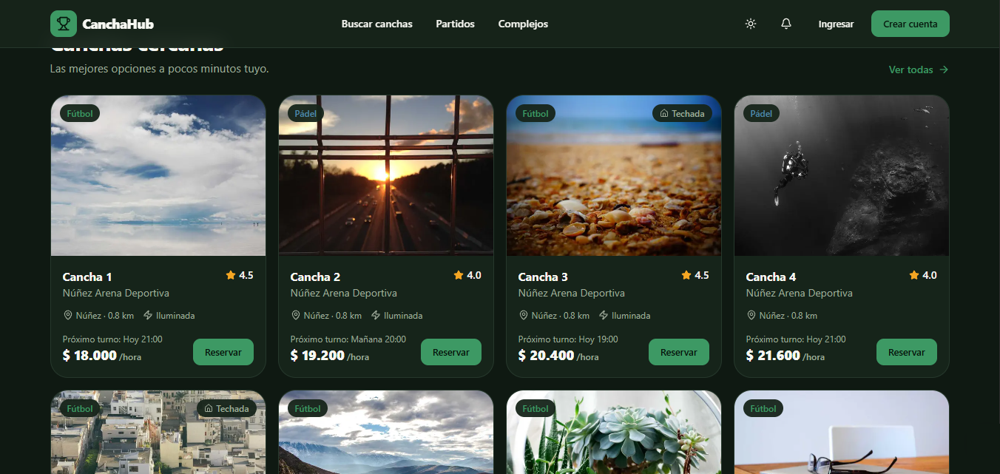

<h1 align="center">Ezequiel Gaona</h1>

  <b>Desarrollador de Software Jr</b> · Backend con Python y Node.js · Sistemas de gestión con IA aplicada 
  Técnico en Programación e Innovación Tecnológica (INCADE) · Posadas, Misiones, Argentina

  
  
  

Construyo sistemas de gestión para negocios reales: ventas, stock, reservas y datos, cada vez más con inteligencia artificial aplicada. Antes de programar trabajé en atención al cliente en una farmacia, y lo que vi ahí (caja, stock, reposición) orienta lo que desarrollo.

Busco mi primera oportunidad como desarrollador junior: backend, software o datos.

---

## Proyecto destacado: Nexora

**Gestión y predicción de ventas para comercios.** Proyecto personal, publicado en Vercel con una demo para probarlo.

- Dashboard con facturación, ganancia, margen, productos más vendidos y alertas de stock.
- Punto de venta con descuento automático de stock y comprobante en PDF.
- Predicción de ventas a 7, 14 y 30 días y alertas por reglas: stock crítico, caída de ventas y margen bajo.
- Asistente de IA que responde consultas leyendo los datos reales del comercio, sin poder modificarlos.
- Reportes exportables a CSV y PDF, usuarios con roles y modo demo con datos ficticios.

  
  

**Stack:** Next.js · React · TypeScript · Tailwind CSS · Supabase (PostgreSQL) · Vercel

**Links:** [Demo](https://nexora-app-ai.vercel.app/) · [Código](https://github.com/EzeGaona21/nexora)

---

## En desarrollo

### CanchaHub

Plataforma web para administrar complejos deportivos y reservar canchas. Proyecto académico, todavía sin publicar: las capturas muestran la interfaz con datos de ejemplo.

  
  

**Stack:** Next.js · React · TypeScript · Tailwind CSS · Supabase

### Sistema de análisis de ventas para PyMEs

Proyecto académico en equipo: importación de datos, estadísticas por período y un agente de IA para proyectar escenarios.

---

## Otros proyectos

| Proyecto | Qué es | Stack |
| --- | --- | --- |
| [Vida+](https://github.com/EzeGaona21/vida-farmacia-final) | Sistema web para una farmacia: API REST de productos (CRUD) y login con roles | Node.js · Express · SQLite |
| [iLib](https://github.com/EzeGaona21/iLib-Sistema) | Gestión de biblioteca de escritorio: libros, usuarios y préstamos | Java · Maven · MySQL · Swing |
| [GymPro](https://github.com/EzeGaona21/GymProfesional) | App Android de rutinas de entrenamiento | Kotlin · SQLite |
| [Login seguro](https://github.com/EzeGaona21/login-seguro-spring) | Login y registro con contraseñas encriptadas | Java · Spring Boot · Spring Security · JPA |
| [Gestor de Tareas](https://github.com/EzeGaona21/Gestor-de-Tareas) | App de escritorio para administrar tareas | Python · Tkinter · SQLite |
| [Análisis de datos](https://github.com/EzeGaona21/Proyecto-Integrador-DATA) | Análisis exploratorio y visualización en Jupyter | Python · pandas · matplotlib |
| [Sheets + n8n](https://github.com/EzeGaona21/tp-sheets-n8n-GCC) | App Inventor conectada a Google Sheets con webhooks de n8n | n8n · Docker · Google Cloud |

---

## Tecnologías

**Lenguajes**

**Backend y bases de datos**

**Frontend**

**Datos y automatización**

**Herramientas**

**Estoy aprendiendo:** FastAPI · Docker

Para desarrollar me apoyo en herramientas de inteligencia artificial.

---

  <a href="https://www.linkedin.com/in/ezequielgaona">LinkedIn</a> · ezequielleonardogaona@gmail.com

